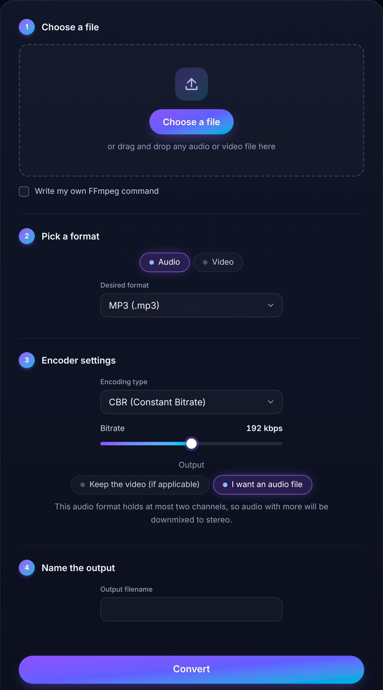

<div align="center">

# AV converter

Convert audio and video files right in your browser using FFmpeg and WebAssembly. Your file is not uploaded.

**Try this web app at [av-converter.com](https://av-converter.com)**

<p>
  
  
  
  
  
  
  
  
</p>

<p>
  
</p>

</div>

# Table of contents

- [Audio/Video Converter](#audiovideo-converter)
- [Run locally](#run-locally)
  - [With Docker](#with-docker)
  - [Without Docker](#without-docker)
- [Video Downloader](#video-downloader)
  - [YouTube cookies](#youtube-cookies)
  - [Password](#password)
  - [Limits](#limits)
- [Production](#production)
- [Tests](#tests)
- [Code layout](#code-layout)
- [License](#license)

## Audio/Video Converter

Convert audio and video files in your browser. The conversion runs on your device with FFmpeg compiled to WebAssembly, so your file is not uploaded.

### Audio

Convert a file, or the audio in a video, to AAC, AC3, ALAC, DTS, FLAC, MP3, Opus, Vorbis or WAV, each with its own settings (such as bitrate).

- The output contains exactly one audio track: the first, unless you pick another once the file's information has loaded (the picker appears for files with several).
- MKA, and outputs that keep the video, can instead hold all audio tracks. MKA does so by default.
- Keeping the video copies it unchanged, into the input's own container (e.g. MP4 stays MP4) when that container can hold the chosen audio format, and into MKV otherwise. For MKV to MKV it also copies the subtitles and attachments.

### Video

Choose **Video** instead of Audio to re-encode the video with any of the video encoders in FFmpeg's WebAssembly build (H.264, H.265, AV1, VP8, VP9, MPEG-4, Theora, ProRes, DNxHR, FFV1, GIF, animated WebP and PNG, and many older, uncompressed and image codecs).

- **Containers and quality:** each encoder offers only the containers it can be written to, and has its own quality settings where it has any.
- **Audio:** it can be re-encoded to any audio format the container can hold, with that format's settings (AAC by default where the container allows it), left as it is (the default for MKV and NUT, which hold almost any audio format), or removed. Audio formats that hold at most two channels, such as MP3, always downmix audio with more to stereo.
- **Size and frame rate:** every encoder can change the frame rate, width and height (all "Original" by default; with only the width or the height set, the other keeps the aspect ratio). Encoders that only allow certain frame sizes (such as DV, H.261 and H.263) resize the video to fit.
- **Trimming:** to convert only part of the video, drag the start and end handles under the video preview. Browsers can't preview every format FFmpeg reads, but the handles still work then.

AV1 can be encoded with libaom or SVT-AV1, and AV1 input is decoded with dav1d (the FFmpeg cores in `vendor/ffmpeg-core` include all three; see its README). libaom is the first choice, because it was faster in our benchmarks in the browser (the numbers are in the [FFmpeg core README](vendor/ffmpeg-core/README.md)) and also works without multi-threading. SVT-AV1 and H.265 need a browser that allows multi-threading (the page must be cross-origin isolated).

### Manual command

Tick **Write my own FFmpeg command** to type everything after `ffmpeg -i <input>` yourself. Manual command mode uses your own stream mapping.

### Saving the converted file

In desktop Chrome, Edge and Opera, clicking **Convert** first asks where to save the converted file. It's then written there a chunk at a time, rather than copied out of FFmpeg's worker whole to be downloaded. Closing the dialog doesn't start the conversion. Other browsers (and Chrome on Android) download the file instead.

### File size and memory

There's no limit on the input file's size: FFmpeg reads it directly from disk. The converted file, though, is held in the browser's memory until it's saved, so a very large output, such as a long video with "Keep the video", can make the browser run out of memory. The page warns about this beforehand (in browsers that report the device's memory), and explains it if the tab crashes during a conversion.

Saving with the dialog (above) needs less memory than downloading. Peak increase in Chromium's memory use, median of three runs in headless Chromium:

| Conversion | Output | Downloaded | Saved |
| --- | --- | --- | --- |
| WAV to WAV | 302 MiB | 1.08 GiB | 0.80 GiB |
| WAV to WAV | 604 MiB | 2.28 GiB | 1.54 GiB |
| MP4 to AAC, keeping the video | 595 MiB | 2.22 GiB | 1.73 GiB |

Most of what's left is FFmpeg's in-memory copy of the output while it's written, which grows by being copied into ever larger buffers.

## Run locally

### With Docker

```sh
docker compose -f docker/dev/docker-compose.yml up --build --watch
```

Open http://localhost:3000. Watch mode syncs frontend changes and restarts or rebuilds services when needed. Downloader rebuilds interrupt active downloads and recordings. Restart the command after changing the Compose configuration.

### Without Docker

Install Python 3.12+, Node.js 26+, Yarn, and FFmpeg, with the executables on your PATH. Start the backend:

```sh
python -m pip install -r downloader/requirements.txt
python downloader/server.py
```

In another terminal, start the frontend:

```sh
yarn install
yarn dev
```

Open http://localhost:3000. Vite proxies download requests to http://127.0.0.1:8000; set `DOWNLOADER_URL` to use another backend. Local downloads need the Vite development server, not the static preview server.

## Video Downloader

A separate page at `/download` that downloads a video or its audio from a link, using [yt-dlp](https://github.com/yt-dlp/yt-dlp) on the server. Unlike the converter, it runs on the server and is protected by a password. It isn't linked from the site.

**To use it:** open `/download`, enter the password and the video's URL, choose what to download (best quality, audio only, MP4 or MP3), and click **Download**. Keep the page open until the file is ready.

### YouTube cookies

If YouTube asks yt-dlp to sign in, export your YouTube cookies in Netscape format and save them as `cookies.txt` in the project root. Without the file, downloads are anonymous. Cookies are login credentials, so never commit them, and expect to replace them when they expire.

### Password

Every download needs the downloader's password.

**How it works**: the password's SHA-256 hash is kept on the server, in `downloader-password.env` in the project root, and never committed. Docker Compose passes it to the downloader as the `DOWNLOADER_PASSWORD_SHA256` environment variable. The download page sends the password with each download request, and the downloader hashes it and compares it with the saved hash. If no hash is set, every download is refused.

**To set or change the password**, run this on the server, from the project root:

```sh
python3 set_password.py
```

It asks for the new password, saves its hash, and restarts the downloader if it's running, so the new password applies straight away. `setup.sh` runs it the first time, and `deploy.py` stops if no password has been set.

Locally, run `python3 set_password.py` too. The Docker setup picks the file up automatically; without Docker, start the backend with `env $(cat downloader-password.env) python downloader/server.py`.

### Limits

At most three downloads run at once (set `MAX_CONCURRENT_DOWNLOADS` to change it); further requests are refused until one finishes. In production, Nginx also lets each IP address start at most 10 downloads a minute (with a burst of 5), which limits password guessing. Downloads have no file-size limit, and live recordings have no duration limit. A download stops if free disk space drops below 1 GiB.

A completed download is kept for up to ten minutes. Its link can be used once; the file is removed when that transfer ends, or when the link expires.

## Production

**First-time setup** of an Ubuntu server, from your normal account:

```sh
sudo bash setup.sh
```

It installs Docker and Node.js, opens ports 80 and 443, builds the site, gets a TLS certificate for the domain set at the top of `setup.sh`, and schedules certificate renewal (`docker/prod/renew-cert.sh`). The domain's DNS must already point at the server. Use `sudo bash setup.sh --local` for HTTP only, without a certificate.

**Updates**: run `yarn deploy` (or `python3 deploy.py`). It pulls the latest code, rebuilds the backend images and the website, restarts what changed and reloads Nginx. Each step is commented in `deploy.py`. There is no automatic rollback, and active downloads are interrupted.

Production requires `cookies.txt` in the project root (`setup.sh` creates an empty one). After replacing it, run:

```sh
docker compose -f docker/prod/docker-compose.yml up -d downloader
```

## Tests

Run backend tests (offline; yt-dlp is never run):

```sh
python -m unittest discover -s downloader -p "test_*.py"
```

Run frontend tests:

```sh
yarn test
```

Lint the frontend with ESLint, including React's hooks rules, and type-check the scripts in `scripts/`:

```sh
yarn lint
```

Two scripts in `scripts/` test the converter in a real browser (Chromium, through Playwright), against the production build. CI doesn't run them:

```sh
yarn build
npx playwright install chromium   # once

# Tests "Keep the video" for every container and audio format that offers it.
# Needs ffmpeg and ffprobe on your PATH.
node scripts/test-keep-video.ts

# Checks which video encoders hang on the multi-threaded core without -threads 4.
node scripts/test-threads.ts path/to/video.mp4
```

Both print one line per case and a summary. `test-keep-video` exits with 1 if any case fails; `--containers mp4,avi` and `--formats AAC,MP3` limit what it tests. `test-threads` also takes `--only libx264,gif`, `--rounds` and `--timeout`. Each script's header comment lists all its options.

GitHub Actions runs both suites, the linter (which also type-checks the scripts) and the frontend build on every push to master and on pull requests.

## Code layout

| Path | What it does |
| --- | --- |
| `src/formats.tsx` | One entry per output format: its label, extension, FFmpeg arguments and settings panel. |
| `src/videoEncoders.tsx` | One entry per video encoder: its label, the containers it can be written to, its FFmpeg arguments and settings panel. |
| `src/components/` | Small shared form controls (select, slider, yes/no radio, file input), the status panel, and the video trimmer. |
| `src/utils/createFFmpegArgs.ts` | Builds the full FFmpeg command: which streams to include (`-map`), the format's arguments, and the shared options (keep the video, downmix to stereo). |
| `src/utils/convertFile.ts` | Runs FFmpeg (WebAssembly) in the browser, and saves the result where the visitor chose or downloads it. |
| `src/utils/ffmpegWorker.ts` | The worker that runs the FFmpeg core: a copy of ffmpeg.wasm's own, which can also read part of a file, so the output can be saved a chunk at a time (`readFileRange.ts`). |
| `src/utils/saveFilePicker.ts` | The browser's "Save as" dialog, where the browser has one. |
| `src/pages/Homepage.tsx` | The converter page. |
| `src/utils/manualCommand.ts` | Checks and builds the arguments for a manual FFmpeg command. |
| `src/pages/DownloadPage.tsx` | The video downloader page, which streams progress from the backend. |
| `scripts/test-keep-video.ts` | Tests "Keep the video" for every container and audio format that offers it, in Chromium (see Tests). |
| `scripts/test-threads.ts` | Checks which video encoders need `-threads 4` on the multi-threaded FFmpeg core, in Chromium (see Tests). |
| `downloader/server.py` | The yt-dlp backend. |
| `set_password.py` | Sets the downloader's password, saving its hash in `downloader-password.env`. |
| `docker/prod/nginx.conf`, `nginx-http.conf` | Nginx for HTTPS, and HTTP only (local mode and first certificate). Both include `locations.conf`, the site's routes, which adds the security headers in `security-headers.conf` and `app-headers.conf`. |
| `logging/index.ts` | Records real visitors' page visits (path, approximate city and country, time zone, device model, platform and browser; not the IP address) in Loki, viewable in Grafana at `/grafana/`. IP geolocation by [DB-IP](https://db-ip.com). |
| `vendor/ffmpeg-core/` | The multi-threaded and single-threaded FFmpeg WebAssembly cores, which Vite bundles as content-hashed assets. Pages that aren't cross-origin isolated (no SharedArrayBuffer) fall back to the single-threaded core. They're built from ffmpeg.wasm's source: the npm release's Opus encoder crashes, and it can't decode or encode AV1. Its README explains why and how to rebuild them. |
| `vendor/ffmpeg-core/patches/` | The patches that add AV1 support to those cores, applied to ffmpeg.wasm when they're rebuilt. See its README. |

To add an output format:

1. Add its name to `Codec` in `src/formats.tsx`.
2. Add any settings it needs to `FormatSettings` and `DEFAULT_SETTINGS` (prefixed with the format's name, e.g. `mp3Bitrate`).
3. Add an entry to `FORMATS` with its label, extension, FFmpeg `args` and settings `Panel`.
4. Add a case to the `formats` list in `src/utils/createFFmpegArgs.test.ts`, with the arguments it should produce.

To add a video encoder:

1. Add an entry to `VIDEO_ENCODERS` in `src/videoEncoders.tsx`, keyed by its FFmpeg name. Give it
   the containers it can be written to (the first is the default), its FFmpeg `args`, and a settings
   `Panel` if it has any.
2. Add any settings it needs to `FormatSettings` and `DEFAULT_SETTINGS` in `src/formats.tsx`.
3. Check that the cores can write each container you list. The encoder has to be in the build (see
   `vendor/ffmpeg-core/README.md`).

## License

[MIT](LICENSE)
