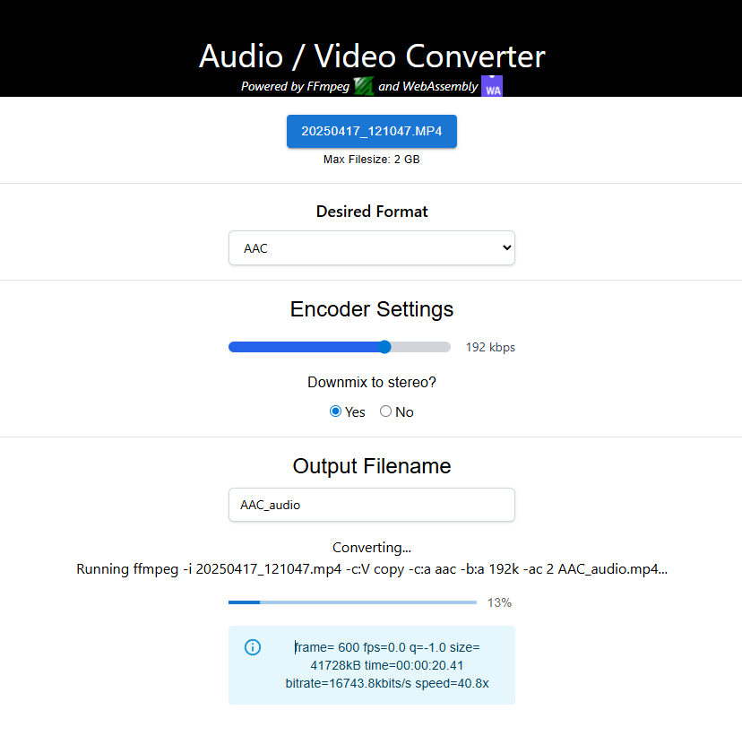

# Audio/video converter

<div align="center">
  
  
  
  
  
  

  
</div>

# Table of contents

- [Audio/Video Converter](#audiovideo-converter)
- [Video Downloader](#video-downloader)
- [Run locally](#run-locally)
  - [With Docker](#with-docker)
  - [Without Docker](#without-docker)
- [YouTube cookies](#youtube-cookies)
- [Downloader limits](#downloader-limits)
- [Tests](#tests)

## Audio/Video Converter

Convert audio files or the audio tracks in a video using FFmpeg in your browser. Supports AAC, AC3, ALAC, DTS, FLAC, MP3, Opus, Vorbis, and WAV.

## Video Downloader

Click on Video Downloader in the navigation bar (or visit /download). This is essentially a [yt-dlp](https://github.com/yt-dlp/yt-dlp) wrapper.
## Run locally

#### With Docker

```sh
docker compose -f docker/dev/docker-compose.yml up --build --watch
```

Open http://localhost:3000. Watch mode syncs frontend changes and restarts or rebuilds services when needed. Downloader rebuilds interrupt active downloads and recordings. Restart the command after changing the Compose configuration.

#### Without Docker

Install Python 3.12+, Node.js 22+, Yarn, and FFmpeg, with the executables on your PATH. Start the backend:

```sh
python -m pip install -r downloader/requirements.txt
python downloader/server.py
```

In another terminal, start the frontend:

```sh
yarn install
yarn dev
```

Open http://localhost:3000. Vite proxies download requests to http://127.0.0.1:8000; set `DOWNLOADER_URL` to use another backend. Downloads need the Vite development server or production Nginx, not the static preview server.

## YouTube cookies

For private, access-controlled deployments, a Netscape-format cookie export can help with YouTube sign-in challenges. **Cookies are login credentials:** never commit them, expose them to visitors, or use a personal session on a public downloader. Sessions can expire or fail to authenticate.

Production Docker requires `cookies.txt` in the project root. Create it before starting the service and make it readable by the container's `downloader` user, using restrictive permissions. It is mounted read-only, not included in the image. After adding or replacing it, run:

```sh
docker compose -f docker/prod/docker-compose.yml up -d --build downloader
docker compose -f docker/prod/docker-compose.yml exec -T nginx nginx -s reload
```

Without Docker, use `downloader/cookies.txt`. Each request gets a temporary copy so the original stays unchanged. Development Docker and non-Docker setups work anonymously when no cookie file is supplied.

## Downloader limits

The backend allows two concurrent extractions. Live recordings have no duration limit, but storage limits still apply.

| Environment variable | Default | Purpose |
| --- | --- | --- |
| `DOWNLOAD_STORAGE_DIR` | OS temp directory + `av-downloader` | Storage root for downloads |
| `DOWNLOAD_STORAGE_QUOTA_BYTES` | `10737418240` (10 GiB) | Maximum total stored bytes; must be positive |
| `DOWNLOAD_MIN_FREE_BYTES` | `1073741824` (1 GiB) | Free space reserve; zero disables it |
| `DOWNLOAD_STORAGE_CHECK_SECONDS` | `1` | Storage check interval; greater than 0, at most 60 seconds |

Storage checks include partial files, completed files awaiting collection (up to ten minutes), and active transfers. Exceeding a limit stops the affected job and removes its files; retained downloads aren't evicted to make room. Requests rejected because both download slots are busy return HTTP 429; requests rejected for storage limits return HTTP 507.

Checks are periodic, so usage can briefly exceed the limit. Use a filesystem or container storage quota for a strict ceiling, and run only one backend process per storage root.

Production Docker limits the downloader to two CPUs and 2 GiB of memory, and keeps its port private.

## Tests

Run backend tests with mocked downloads and no external network access:

```sh
python -m unittest discover -s downloader -p "test_*.py"
```

Run frontend tests:

```sh
yarn test
```

GitHub Actions runs both suites and the production build on every push to master and on pull requests.
